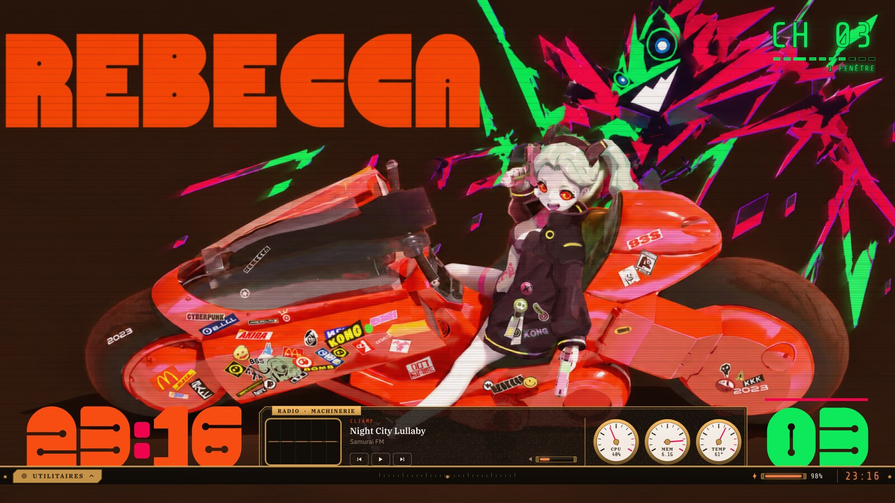
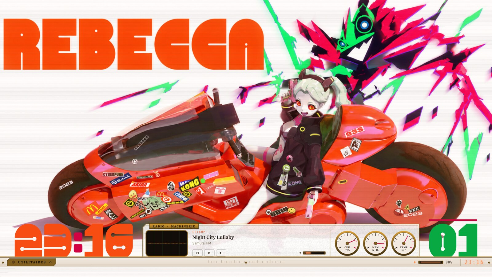
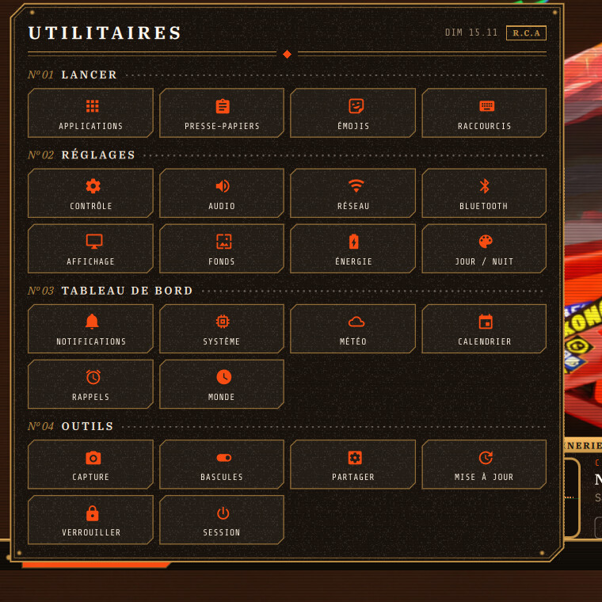
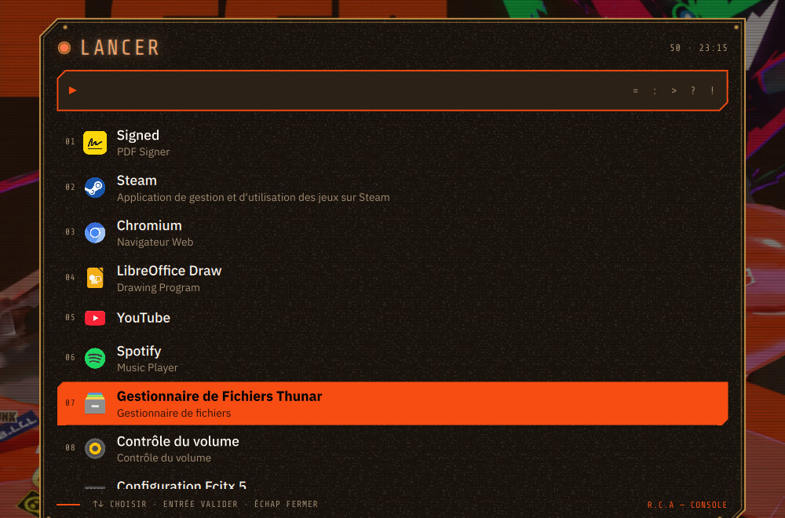
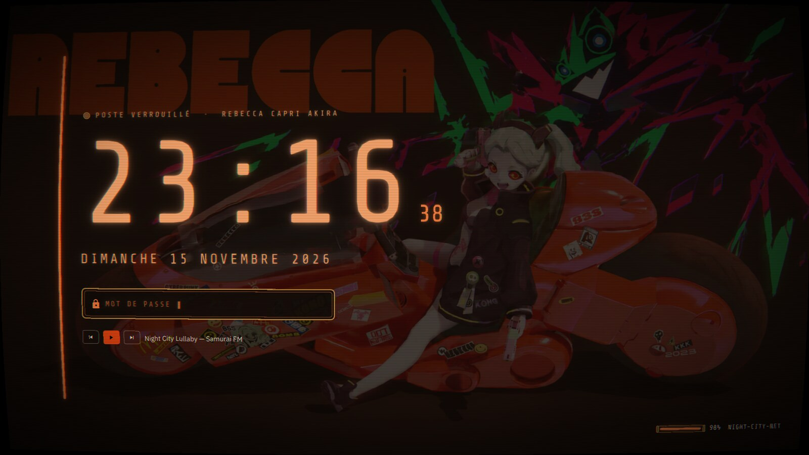

# Rebecca-Capri-Akira

**Un rice Arch + Hyprland complet, sans Omarchy : vintage classe (Art déco, hi-fi des
années 50, imprimerie) relevé de laiton et de néon, autour de Rebecca, Capri et la moto
d'*Akira*.**





| Menu Utilitaires | Lanceur | Verrouillage |
|---|---|---|
|  |  |  |

## Ce qu'il y a dedans

- **Jour / nuit au soleil** : palette Rebecca claire au lever, Rebecca Dark au coucher (heures
  calculées pour ta position), veilleuse le soir. Fond, terminal, GTK, Qt, Hyprland, Neovim,
  btop, VS Code et Firefox basculent ensemble.
- **Fond vivant** : l'heure et le numéro d'espace de travail dessinés dans le lettrage du titre
  « REBECCA ». Sur un espace vide, la radio (lecture en cours, oscilloscope) et trois manomètres
  s'allument ; ils s'éteignent dès qu'une fenêtre s'ouvre.
- **Code couleur** : orange pour Rebecca, vert et magenta de Capri pour tout ce qui est
  technique (système, réseau, espace de travail, assistant vocal, modes avancés du lanceur).
- **Pupitre** de 32 px : levier « Utilitaires » (menu de tous les panneaux), batterie, heure.
  Il ne se replie jamais tout seul.
- **Un seul processus Quickshell** pour toute l'interface : panneaux (son, réseau, Bluetooth,
  affichage, énergie, calendrier, météo, système, notifications, rappels, fonds), lanceur
  (applis, menus, presse-papiers, émojis, calcul, commandes, raccourcis, ricings),
  notifications, verrouillage, agent polkit. Les panneaux ne sont chargés qu'à l'ouverture.
- **Sélecteur de ricings** dans la palette : `ricing switch` sans argument ouvre le mode
  « Ricings » (rofi reste le secours). `default`, dont l'interface était Omarchy, est masqué
  par `hidden=true` et n'est plus proposé.
- **Fenêtres en biseau** (`rounding_power = 1`), marges minimales, animations d'allumage de
  tube et défilement vertical des espaces.
- **Raccourcis d'Omarchy** réécrits en Lua, AZERTY compris (codes physiques).

## Prérequis

Arch Linux, Hyprland 0.56+ (config Lua), Quickshell 0.3+. Tous les paquets viennent des
dépôts officiels ; la liste est dans [`ricing.conf`](ricing.conf) (`packages=`).

## Installation

### Avec [ricecooker / hypr-switch](https://github.com/Loup-cmd/ricecooker) (recommandé)

```bash
git clone https://github.com/Loup-cmd/rebecca-capri-akira ~/.hypr-switch/shells/Rebecca-Capri-Akira
ricing deps Rebecca-Capri-Akira        # paquets + setup.sh
ricing switch Rebecca-Capri-Akira      # bascule à chaud ; retour : ricing switch default
```

### Depuis Omarchy, jusqu'à sa désinstallation

[`transition.sh`](transition.sh) fait tout, en sept étapes qui demandent chacune ton accord et
reprennent après interruption : paquets, bascule, applis, autres ricings, noyau Arch + greetd,
retrait d'Omarchy (en conservant le déverrouillage du disque chiffré et la config Limine),
nettoyage après redémarrage. Détails et secours : [`MIGRATION.md`](MIGRATION.md).

```bash
~/.hypr-switch/shells/Rebecca-Capri-Akira/transition.sh --dry-run   # aperçu
~/.hypr-switch/shells/Rebecca-Capri-Akira/transition.sh
```

> Le script a été écrit pour une machine précise (LUKS + btrfs + Limine + SDDM). Lis la
> simulation avant de lancer la version réelle sur la tienne.

### Sans hypr-switch

Copier le contenu de `configs/config/` dans `~/.config/`, puis `bash setup.sh`. Le shell se lance
avec `qs -c rca` (ajouté au démarrage par `configs/config/hypr/rca/autostart.lua` via
`ricing.conf` : reprendre les lignes `start=` dans ton autostart).

## Réglages

`~/.config/rca/settings.conf` : position (lever/coucher), veilleuse, villes de l'horloge
mondiale, ville de la météo, dossiers de captures, `crt_shader=off` pour couper l'effet
cathodique. Réglages Hyprland personnels : `~/.config/rca/user.lua` (chargé en dernier).

Scripts utiles (`~/.config/rca/bin/`) :

| Script | Rôle |
|---|---|
| `rca-theme light\|dark\|toggle\|auto\|status` | thème jour / nuit |
| `rca-theme wallpaper <fichier\|next>` | fond de la période courante |
| `rca-wallgen` | régénère les fonds secondaires (néon, salle des machines, mire) |
| `rca-capture shot\|record\|ocr\|color` | captures, enregistrement, OCR, pipette |
| `rca-freeze-keymap <ricing>` | rend un autre ricing hypr-switch indépendant d'Omarchy |

## Structure

```
ricing.conf, setup.sh, transition.sh   métadonnées hypr-switch, installation, migration
configs/config/hypr/                   Hyprland Lua (rca/binds.lua : tous les raccourcis)
configs/config/quickshell/rca/         shell : services/, modules/, panels/, components/
configs/config/rca/                    scripts, palettes, modèles de thème, fonds, réglages
configs/config/{kitty,gtk-*,qt6ct}/    terminal et boîtes à outils
tools/sync.sh                          recopie le ricing installé dans ce dépôt
```

## Crédits et licences

Code et configuration : MIT, voir [LICENSE](LICENSE). Emprunts et images : voir
[NOTICE.md](NOTICE.md) — les illustrations Rebecca appartiennent à leurs ayants droit et ne
sont pas couvertes par la licence MIT.
